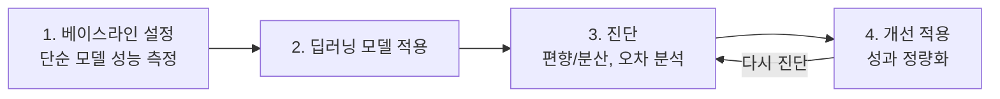
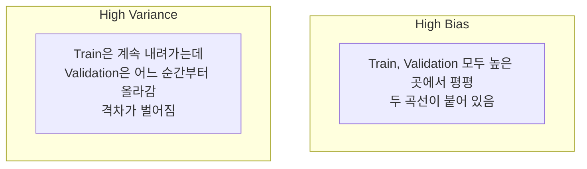
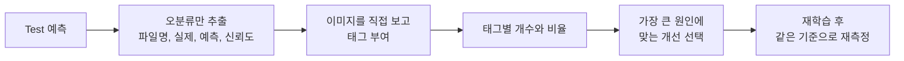

# A6-2 개념 정리 — 전이 학습, 시계열 예측, 편향/분산 진단과 오차 분석

이 문서는 A6-2 과제를 혼자 수행하는 데 필요한 개념을 처음부터 설명합니다. 정답 코드는 담지 않았습니다. 대신 각 개념이 "왜 필요한지", "손으로 계산하면 어떤 숫자가 나오는지", "과제의 어떤 결과물로 이어지는지"를 보여 줍니다.

- 과제 원문과 요구사항: [../subject.md](../subject.md)
- 실제 작업 순서와 체크포인트: [WALKTHROUGH.md](WALKTHROUGH.md)

과제는 트랙 A(이미지 전이 학습)와 트랙 B(시계열 예측) 두 가지로 구성되고, 두 트랙 모두 **(1) 베이스라인 설정 → (2) 딥러닝 모델 적용 → (3) 편향/분산 진단 및 오차 분석 → (4) 개선 적용 및 성과 정량화**라는 같은 사이클을 따릅니다. 이 문서도 공통 개념 → 트랙 A → 트랙 B → 공통 마무리 순서로 진행합니다.

> **용어 규칙:** 과제는 문서 전반에서 **Train / Validation / Test**로 용어를 통일하라고 요구합니다(Dev, Val 등 혼용 금지). 과제 목표 문장의 "Dev"는 Validation과 같은 뜻이지만, 여러분의 리포트와 그래프 범례에서는 반드시 Validation이라고 씁니다. 이 문서도 같은 규칙을 따릅니다.

## 읽는 순서

| 순서 | 배울 내용 | 이걸 알면 할 수 있는 일 |
| --- | --- | --- |
| 1 | 성능 개선 사이클과 베이스라인의 의미 | 왜 베이스라인을 먼저 만들어야 하는지 설명하기 |
| 2 | Train / Validation / Test 분할 | 각 세트의 역할을 지키며 실험하기 |
| 3 | 편향과 분산, 학습 곡선 | Loss 곡선의 격차로 High Bias / High Variance 진단하기 |
| 4 | CNN과 사전학습 모델 | ResNet, EfficientNet이 이미지를 처리하는 방식 이해하기 |
| 5 | 전이 학습: Linear Probing vs Fine-tuning | 데이터 크기에 맞는 Layer Freezing 전략 고르기 |
| 6 | Few-shot 데이터 구성과 이미지 증강 | 클래스당 50장 미만 데이터셋 만들고 증강 적용하기 |
| 7 | 분류 결과 읽기: 신뢰도, 혼동 행렬 | 오분류 이미지와 신뢰도 추출하기 |
| 8 | 오차 분석 (Human-in-the-loop) | 30건 이상 태깅하고 통계와 갤러리 만들기 |
| 9 | 시계열 데이터와 윈도우 | 주가 데이터를 입력/정답 쌍으로 바꾸기 |
| 10 | 시계열 베이스라인 | Naive, SMA, EMA, 선형 회귀 예측 계산하기 |
| 11 | RNN, LSTM, GRU | 시계열 모델 구조를 이해하고 CNN과 구분하기 |
| 12 | 회귀 평가 지표 | MAE, RMSE, MAPE와 개선율(%) 계산하기 |
| 13 | Data Leakage | 누수 방지 체크포인트 4개를 지키고 근거 쓰기 |
| 14 | 필수 시각화 4종 | 각 그래프가 무엇을 증명하는지 알고 그리기 |
| 15 | 보너스 개념 | Random Search, Coarse-to-Fine, Attention |

## 1. 성능 개선 사이클과 베이스라인

### 비유: 새로 산 비싼 운동화

"이 운동화를 신으면 기록이 좋아진다"고 주장하려면, 먼저 **평소 운동화로 달린 기록**이 있어야 합니다. 그 기록 없이 새 운동화 기록만 보여 주면 좋아진 건지 원래 빨랐던 건지 알 수 없습니다. 베이스라인은 "평소 운동화 기록"입니다.

### 정의

**베이스라인(baseline)**은 아주 단순한 방법으로 얻은 기준 성능입니다. 딥러닝 모델이 이 기준보다 나아야 "딥러닝을 쓸 가치가 있다"고 말할 수 있습니다. 과제는 베이스라인을 **딥러닝 모델 학습 전에 먼저 구현하고 성능을 측정**하라고 요구합니다([../subject.md](../subject.md) 7장). 순서가 바뀌면 딥러닝 결과를 본 뒤 베이스라인을 약하게 만들고 싶은 유혹이 생기기 때문입니다.

| 트랙 | 베이스라인 | 딥러닝 모델 | 진단 도구 |
| --- | --- | --- | --- |
| A (이미지) | Linear Probing (분류기만 학습) | 전체 Fine-tuning | Train/Validation Loss 곡선, 오분류 이미지 태깅 |
| B (시계열) | Naive, SMA, EMA, 선형 회귀 중 2개 이상 | LSTM 또는 GRU | Train/Validation Loss 곡선, 예측 vs 실제 그래프 |

트랙 A에서 Linear Probing을 꼭 "베이스라인"이라고 부를 필요는 없지만, 과제는 두 방식의 비교를 요구하므로 비교의 기준점 역할을 합니다.

## 2. Train / Validation / Test 분할

### 비유: 문제집, 모의고사, 수능

- **Train**은 문제집입니다. 풀고 해설을 보며 배웁니다(가중치 학습).
- **Validation**은 모의고사입니다. 공부 방법(하이퍼파라미터, 모델 선택, 조기 종료)을 바꿀지 결정하는 데 씁니다.
- **Test**는 수능입니다. 마지막에 **한 번** 보고 최종 성능으로 보고합니다.

모의고사 점수를 보고 공부 방법을 계속 바꾸면 모의고사에 맞춰진 실력이 됩니다. 그래서 수능(Test)은 그 과정에 쓰지 않고 남겨 둡니다. Test 결과를 보고 다시 모델을 고치면 Test가 Validation처럼 오염됩니다.

### 과제에서의 분할

| 트랙 | 분할 방법 | 규칙 |
| --- | --- | --- |
| A | 클래스별로 Train/Validation/Test를 나눔 | 같은 이미지가 두 세트에 동시에 들어가면 안 됨 |
| B | **시간순으로** Train → Validation → Test = 7 : 1 : 2 | shuffle 금지 |

손 계산: 3년 일봉은 거래일 기준 대략 연 252일 × 3 = 756행입니다. 7:1:2로 나누면 Train 529행, Validation 76행, Test 151행 정도입니다(반올림 방식에 따라 1행 차이는 날 수 있음).

## 3. 편향(Bias)과 분산(Variance)

### 비유: 다트 던지기

- **높은 편향:** 다트가 한쪽에 모여 있지만 과녁 중심에서 멀리 떨어져 있습니다. 실력 자체가 부족합니다(**과소적합, Underfitting**).
- **높은 분산:** 연습 과녁에서는 정중앙을 맞히는데, 실전 과녁에서는 사방으로 흩어집니다. 연습 과녁의 특징을 외웠을 뿐입니다(**과적합, Overfitting**).

### 진단 기준

과제 4장의 표를 정리하면 다음과 같습니다.

| 상태 | Train Loss | Validation Loss | 두 곡선의 격차 | 해결책 |
| --- | --- | --- | --- | --- |
| High Bias | 높음 | 높음 | 작음 (비슷) | 모델 복잡도 증가, 더 오래 학습, 동결 층 해제 |
| High Variance | 낮음 | 높음 | 큼 | 정규화(Dropout, L2), 데이터 증강, 데이터 추가, 조기 종료 |
| 양호 | 낮음 | 낮음 | 작음 | 유지 |

"높다/낮다"는 **기준이 있어야** 말할 수 있습니다. 기준으로는 사람 수준의 오류, 또는 베이스라인 성능을 씁니다. 예를 들어 시계열에서 LSTM의 Train 오차가 Naive 베이스라인의 오차보다도 크다면 Train에서조차 단순 규칙을 못 이기는 것이므로 High Bias 신호입니다.

### 학습 곡선 모양

### 손 계산 예시

과제의 진단 리포트 예시를 숫자로 읽어 봅니다. Train 정확도 99%, Validation 정확도 75%입니다.

- Train 오류율 1%, Validation 오류율 25%
- 격차 24%p로 매우 큼 → **High Variance**
- 해결책: Dropout 비율 상향, L2 규제, 데이터 증강

반대로 Train 70%, Validation 68%라면 격차는 2%p로 작지만 Train 자체가 낮으므로 **High Bias**입니다. 동결했던 층을 풀거나 더 큰 모델을 시도합니다.

### 흔한 오해

- "Validation Loss가 Train보다 높으면 무조건 과적합" — 약간 높은 것은 정상입니다. **격차의 크기와 추세**(격차가 에폭마다 벌어지는지)를 봅니다.
- "한 번 진단하면 끝" — 해결책을 적용한 뒤 다시 곡선을 그려 상태가 바뀌었는지 확인하는 것이 사이클의 4단계입니다.

## 4. CNN과 사전학습 모델

### 합성곱의 직관

**비유:** 돋보기(필터)를 들고 사진을 왼쪽 위부터 한 칸씩 훑으며 "여기 세로 경계선이 있나?"를 확인하는 것입니다. 같은 돋보기를 사진 전체에 쓰므로 **가중치 공유**가 일어나고, 고양이 귀가 사진 왼쪽에 있든 오른쪽에 있든 찾을 수 있습니다.

### 손 계산

3×3 입력 조각과 세로 경계 필터를 원소별로 곱해 더합니다.

$$
\text{입력} = \begin{bmatrix} 9 & 9 & 0 \\ 9 & 9 & 0 \\ 9 & 9 & 0 \end{bmatrix}, \quad
\text{필터} = \begin{bmatrix} 1 & 0 & -1 \\ 1 & 0 & -1 \\ 1 & 0 & -1 \end{bmatrix}
$$

결과는 $9+9+9 - (0+0+0) = 27$입니다. 왼쪽이 밝고 오른쪽이 어두운 경계에서 큰 값이 나옵니다. 입력이 모두 9로 균일하면 $27 - 27 = 0$입니다.

### 계층적 특징

CNN은 층이 깊어질수록 더 복잡한 특징을 잡습니다.

| 층 위치 | 잡는 특징 | 다른 데이터셋에서의 재사용성 |
| --- | --- | --- |
| 앞쪽 층 | 선, 경계, 색 대비 | 매우 높음 |
| 중간 층 | 질감, 반복 무늬, 간단한 형태 | 높음 |
| 뒤쪽 층 | 눈, 바퀴, 꽃잎 같은 부분 | 데이터셋에 따라 다름 |
| 마지막 분류층 | 원래 데이터셋의 클래스(예: ImageNet 1000개) | 거의 없음 → 교체 대상 |

### 사전학습 모델

**사전학습(pretrained) 모델**은 ImageNet 같은 대규모 데이터셋으로 이미 학습된 모델입니다. 과제는 ResNet, EfficientNet 등 CNN 기반 사전학습 모델을 사용하라고 합니다.

- **ResNet:** 층의 입력을 출력에 더하는 지름길(residual connection, $\text{out} = F(x) + x$)을 두어 깊은 망에서도 기울기가 잘 흐르게 한 구조입니다. ResNet-18은 파라미터가 약 1,170만 개입니다.
- **EfficientNet:** 깊이, 너비, 입력 해상도를 균형 있게 키우도록 설계된 계열입니다.

PyTorch에서는 `torchvision.models`, TensorFlow에서는 `tf.keras.applications`에서 불러옵니다. 과제는 둘 중 하나를 쓰도록 합니다([../subject.md](../subject.md) 6장).

### CNN과 RNN의 차이 (과제 목표 항목)

| 구분 | CNN | RNN (LSTM/GRU) |
| --- | --- | --- |
| 데이터 구조 | 공간적 격자 (이미지의 가로×세로) | 순서가 있는 시퀀스 (시간) |
| 핵심 가정 | 가까운 픽셀끼리 관련 있음, 위치와 무관한 패턴 | 과거가 현재에 영향을 줌 |
| 가중치 공유 | 공간 위치 간 공유 (필터) | 시점 간 공유 (같은 셀을 반복 적용) |
| 정보 흐름 | 한 번에 전체 입력 처리 | 앞 시점의 은닉 상태를 다음 시점으로 전달 |
| 과제 적용 | 트랙 A: 이미지 분류 | 트랙 B: 주가/경제 데이터 예측 |

## 5. 전이 학습: Linear Probing vs Fine-tuning

### 비유: 경력직 채용

피아노를 10년 친 사람에게 오르간을 가르치는 상황입니다. 손가락 기술(앞쪽 층)은 그대로 쓰고, 페달 쓰는 법(마지막 층)만 새로 배우면 됩니다. 시간이 충분하면 손가락 습관도 오르간에 맞게 조금 다듬을 수 있습니다.

### 두 방식

| 방식 | 학습되는 부분 | 장점 | 위험 |
| --- | --- | --- | --- |
| Linear Probing (분류기만 학습) | 새로 붙인 마지막 분류층만 | 파라미터가 적어 과적합 위험 낮음, 빠름 | 특징이 새 데이터와 안 맞으면 성능 한계 (High Bias 가능) |
| Fine-tuning (전체 미세 조정) | 모든 층 | 새 데이터에 맞춰 특징까지 조정, 성능 상한이 높음 | 데이터가 적으면 과적합 (High Variance 가능), 사전학습 특징 손상 |

### 손 계산: 학습 파라미터 수

ResNet-18의 마지막 특징 차원은 512입니다. 3클래스 분류기를 붙이면

$$512 \times 3 + 3 = 1{,}539 \text{ 개}$$

Linear Probing은 이 1,539개만 학습하고, Fine-tuning은 약 1,170만 개 전체를 학습합니다. 학습 이미지가 3클래스 × 40장 = 120장이라면, 1,170만 개 파라미터를 120장으로 조정하는 것은 과적합되기 쉽다는 것을 숫자로 느낄 수 있습니다.

### Layer Freezing 전략 (과제 목표 항목)

**동결(freeze)**은 해당 층의 가중치를 학습에서 제외하는 것입니다. 데이터 크기와 원래 데이터(ImageNet)와의 유사도에 따라 동결 범위를 정합니다.

| 내 데이터 크기 | ImageNet과 유사함 (개, 고양이, 음식) | ImageNet과 다름 (의료 영상, 위성 사진) |
| --- | --- | --- |
| 작음 (Few-shot) | Linear Probing 우선 | Linear Probing, 또는 뒤쪽 일부 층만 신중히 해제 |
| 큼 | 뒤쪽 층 또는 전체 Fine-tuning | 전체 Fine-tuning |

과제의 필수 비교는 **Linear Probing vs 전체 Fine-tuning** 두 가지입니다. 마지막 블록만 푸는 부분 Fine-tuning을 추가로 비교하면 "최적의 범위 결정" 목표를 더 잘 보여 줄 수 있습니다(권장).

### 실무 주의점

- **학습률:** Fine-tuning에서는 사전학습 가중치를 크게 망가뜨리지 않도록 Linear Probing보다 작은 학습률을 쓰는 것이 일반적입니다. 분류층과 나머지에 다른 학습률을 줄 수도 있습니다.
- **입력 전처리:** 사전학습 때와 같은 크기 조정과 정규화(ImageNet 평균/표준편차)를 써야 합니다. torchvision의 가중치 객체는 맞는 전처리를 함께 제공합니다(`weights.transforms()`).
- **BatchNorm:** PyTorch에서 `model.train()` 상태면 가중치를 동결해도 BatchNorm의 이동 평균 통계는 계속 갱신됩니다. Linear Probing을 "특징 추출기를 완전히 고정"한 상태로 하려면 백본을 평가 모드로 두는 등 처리 방식을 정하고 리포트에 적습니다.
- **동결 확인:** 동결 후 `requires_grad=True`인 파라미터 수를 세어 보면 의도대로 됐는지 바로 알 수 있습니다.

## 6. Few-shot 데이터 구성과 이미지 증강

### Few-shot 조건

과제는 **클래스당 50장 미만**의 환경을 요구합니다. 추천 데이터셋은 Dogs vs Cats(Kaggle), Food-101 일부, Oxford Flowers 102 일부, CIFAR-10 일부 클래스입니다. 큰 데이터셋에서 필요한 클래스 폴더만 골라 복사하는 방법은 과제의 데이터셋 가이드에 나와 있습니다(`shutil`, `os`).

| 결정할 것 | 고려할 점 |
| --- | --- |
| 클래스 수 | 2~10개. 클래스가 비슷할수록 어렵고 오차 분석 재료가 많아짐 |
| 클래스당 Train 장수 | 50장 미만 (예: 30~40장) |
| Validation, Test 장수 | 각 세트에 클래스별로 고르게 배분 |
| 무작위 선택 | 시드를 고정해 재현 가능하게 |

**오차 분석 30건 문제:** 오차 분석표는 오분류 **최소 30건**을 요구합니다. Test가 작고 모델이 잘 맞히면 30건이 안 나올 수 있습니다. 클래스를 비슷한 것끼리 고르거나 클래스 수를 늘리는 방법, Linear Probing과 Fine-tuning 두 모델의 오분류를 함께 분석하는 방법 등이 있습니다. 어떤 방식으로 30건을 모았는지 리포트에 밝힙니다.

### 이미지 증강

**비유:** 같은 사람 사진을 밝게, 어둡게, 좌우 반전해서 보여 주면 "조명이 달라도 같은 사람"임을 배웁니다.

| 증강 | 예시 변환 | 오차 분석 태그와의 연결 |
| --- | --- | --- |
| 밝기/대비 변화 | ColorJitter, RandomBrightness | 데이터 품질 (어두운 조명) |
| 좌우 반전 | RandomHorizontalFlip | 일반적인 위치 변화 |
| 무작위 자르기 | RandomResizedCrop | 배경/잡음, 객체 일부만 보임 |
| 흐림 | GaussianBlur | 데이터 품질 (흐림) |

증강은 **Train에만** 적용합니다. Validation/Test는 크기 조정과 정규화만 합니다. 과제 결과 예시처럼 "오분류의 60%가 어두운 조명 → 밝기 증강 적용 → 정확도 향상"처럼 **오차 분석 결과에서 증강을 고르는 것**이 핵심입니다.

## 7. 분류 결과 읽기: 신뢰도와 혼동 행렬

### 신뢰도

모델의 출력 점수(logit)에 Softmax를 적용한 확률 중 가장 큰 값을 **신뢰도**로 씁니다.

$$p_i = \frac{e^{z_i}}{\sum_j e^{z_j}}, \qquad \text{신뢰도} = \max_i p_i$$

손 계산: 2클래스(Cat, Dog) logit이 $[0.0, 0.08]$이면 $p_{\text{Dog}} = e^{0.08}/(1 + e^{0.08}) \approx 0.52$입니다. 정답이 Cat인데 0.52로 Dog라고 했다면 "헷갈려서 틀린" 경우이고, 0.95로 틀렸다면 "확신하며 틀린" 경우입니다. 과제 태그 체계에서 후자는 **모델 한계**(신뢰도는 높으나 잘못 예측) 후보입니다. 확신하며 틀린 사례는 **라벨 오류**일 가능성도 있으므로 이미지를 직접 확인합니다.

### 혼동 행렬

실제 클래스(행)와 예측 클래스(열)의 개수 표입니다.

| 실제 \ 예측 | Cat | Dog |
| --- | --- | --- |
| Cat | 40 | 10 |
| Dog | 5 | 45 |

정확도는 $(40+45)/100 = 85\%$이고, 오분류는 $10 + 5 = 15$건입니다. 어떤 방향의 실수가 많은지(Cat → Dog가 10건) 한눈에 보입니다.

## 8. 오차 분석 (Error Analysis)

### 왜 사람이 직접 보나

정확도 85%라는 숫자는 "얼마나" 틀리는지만 알려 주고 "왜" 틀리는지는 알려 주지 않습니다. 과제는 오분류 이미지를 **사람이 직접 확인(Human-in-the-loop)**하고 태깅하라고 요구합니다. 자동 분류나 추측으로 태그를 채우면 안 됩니다.

### 절차

### 태그 체계 (과제 권장 카테고리)

| 태그 카테고리 | 예시 | 개선 방향 |
| --- | --- | --- |
| 데이터 품질 | 어두운 조명, 흐림, 해상도 부족 | 데이터 증강 |
| 배경/잡음 | 복잡한 배경, 객체 가림 | 배경 제거/증강 |
| 클래스 유사성 | 유사 품종, 형태적 유사성 | 특징 학습 강화 |
| 라벨 오류 | 원본 라벨링 오류 의심 | 데이터 정제 |
| 모델 한계 | 신뢰도는 높으나 잘못 예측, 변별력 부족 | 모델 구조 변경 |

한 이미지에 원인이 여러 개로 보이면 "주 원인 태그 하나"를 정하는 규칙을 두면 통계가 깔끔해집니다(권장). 여러 태그를 허용한다면 비율의 합이 100%를 넘는다는 점을 표에 밝힙니다.

### 통계 손 계산

오분류 40건을 태깅한 결과가 다음과 같다고 합니다.

| 태그 | 건수 | 비율 |
| --- | --- | --- |
| 데이터 품질 | 18 | $18/40 = 45\%$ |
| 클래스 유사성 | 10 | $25\%$ |
| 배경/잡음 | 7 | $17.5\%$ |
| 모델 한계 | 3 | $7.5\%$ |
| 라벨 오류 | 2 | $5\%$ |

가장 큰 원인이 데이터 품질(45%)이므로, 조명·흐림 관련 증강을 첫 개선 후보로 고르는 것이 논리적입니다. 개선 후 같은 Test 세트로 정확도와 태그 분포를 다시 측정하면 개선을 정량화할 수 있습니다. 개선안 선택과 조정은 Validation으로 하고, Test는 최종 비교에만 쓰는 원칙을 지킵니다.

### 흔한 오해

- "오분류 이미지 몇 장만 보고 결론" — 과제 기준은 최소 30건이고, 통계(개수, 비율)가 함께 있어야 합니다.
- "태그는 모델 신뢰도로 자동 분류해도 된다" — 신뢰도는 참고 정보일 뿐, 태그는 사람이 이미지를 보고 판단합니다.

## 9. 시계열 데이터와 윈도우

### 시계열이란

시간 순서대로 기록된 값입니다. 일봉(daily) 주가는 하루에 한 행이며 시가(Open), 고가(High), 저가(Low), 종가(Close), 거래량(Volume)이 있습니다. 과제의 최소 기준은 **1개 티커, 최소 3년 일봉**입니다. 주말과 공휴일에는 거래가 없어 날짜가 건너뜁니다.

`yfinance`로 받는 예시는 과제의 데이터셋 가이드에 있습니다. 인터넷을 쓸 수 없으면 제공 CSV를 사용할 수 있습니다. 같은 실험을 다시 돌릴 수 있도록 받은 데이터를 CSV로 저장해 두고, 시작일과 종료일을 고정하는 것이 좋습니다(권장).

### 슬라이딩 윈도우

딥러닝 모델은 "과거 $L$일을 보고 다음 날을 예측"하도록 학습합니다. 이를 위해 시계열을 (입력, 정답) 쌍으로 자릅니다.

$$X_t = [y_{t-L}, \dots, y_{t-1}], \qquad \text{정답} = y_t$$

손 계산: 시계열 $[10, 12, 11, 13, 14, 15]$, $L = 3$이면

| 입력 $X$ | 정답 |
| --- | --- |
| $[10, 12, 11]$ | 13 |
| $[12, 11, 13]$ | 14 |
| $[11, 13, 14]$ | 15 |

길이 $N$의 시계열에서 쌍은 $N - L$개 나옵니다. 정답 $y_t$가 입력에 포함되거나, 입력이 $t$ 이후 값을 포함하면 **Look-ahead Bias**(미래 엿보기)입니다.

### 원스텝 예측과 공정 비교

이 과제의 베이스라인 수식은 모두 "어제까지의 실제 값을 알고 오늘을 예측"하는 **원스텝(one-step-ahead) 예측**입니다. 딥러닝 모델도 같은 방식(실제 과거 $L$일 → 다음 하루)으로 평가해야 비교가 공정합니다. 그리고 과제는 **모든 모델을 동일한 Test 구간에서 평가**하라고 요구하므로, 각 모델의 예측이 정확히 같은 날짜들에 대해 계산되었는지 확인합니다.

## 10. 시계열 베이스라인

과제는 아래 네 가지 중 **최소 2개**를 구현하도록 합니다.

| 베이스라인 | 수식 | 직관 |
| --- | --- | --- |
| Naive Forecast | $\hat{y}_t = y_{t-1}$ | "내일도 오늘과 같다" |
| 단순 이동평균 (SMA) | $\hat{y}_t = \frac{1}{n}\sum_{i=1}^{n} y_{t-i}$ | 최근 $n$일 평균 |
| 지수 이동평균 (EMA) | $\hat{y}_t = \alpha y_{t-1} + (1-\alpha)\hat{y}_{t-1}$ | 최근 값일수록 가중치 큼 |
| 선형 회귀 | $\hat{y}_t = a t + b$ | 시간에 대한 직선 추세 |

과제의 파라미터 가이드는 SMA 창 5/10/20일 중 선택(각각 비교 권장), EMA $\alpha$ 0.1/0.3/0.5 중 선택(클수록 최근 값에 민감), 선형 회귀 입력은 시간 인덱스 또는 지연값(lag feature)입니다.

### 손 계산

시계열 $y = [10, 12, 11, 13, 14]$ ($t = 1..5$)로 $t = 6$을 예측합니다.

- **Naive:** $\hat{y}_6 = y_5 = 14$
- **SMA(3):** $\hat{y}_6 = (11 + 13 + 14)/3 \approx 12.67$
- **EMA($\alpha = 0.5$):** 시작값을 $\hat{y}_2 = y_1 = 10$으로 두면
  - $\hat{y}_3 = 0.5 \times 12 + 0.5 \times 10 = 11$
  - $\hat{y}_4 = 0.5 \times 11 + 0.5 \times 11 = 11$
  - $\hat{y}_5 = 0.5 \times 13 + 0.5 \times 11 = 12$
  - $\hat{y}_6 = 0.5 \times 14 + 0.5 \times 12 = 13$

EMA는 SMA보다 최근 상승(13, 14)을 더 빨리 따라갑니다. 시작값 정하는 규칙은 리포트에 적습니다.

### 선형 회귀 베이스라인

시간 인덱스 $t$를 입력으로 쓰면 Train 구간에서 $a$, $b$를 구해 Test 구간으로 직선을 연장합니다. 추세가 바뀌면 크게 빗나갑니다. 지연값을 입력으로 쓰면($\hat{y}_t = w_1 y_{t-1} + \dots + w_k y_{t-k} + b$) 원스텝 예측이 되어 Naive와 비슷한 성능이 나오는 경우가 많습니다. 어느 쪽이든 **계수는 Train 구간으로만 구합니다.**

### 구현할 때의 함정: 한 칸 밀기

pandas의 `rolling(n).mean()`과 `ewm(alpha=..., adjust=False).mean()`은 **오늘 값까지 포함한** 평균을 돌려줍니다. 이 값을 오늘의 예측으로 쓰면 정답을 보고 예측하는 셈입니다. 과제 수식처럼 $t-1$까지만 쓰려면 결과를 한 칸 뒤로 밀어야 합니다(`shift(1)`). 이 실수는 베이스라인을 비정상적으로 좋게 만들어 비교 전체를 무너뜨립니다.

### Naive가 강한 이유

주가는 하루 사이 변화가 작고 방향을 예측하기 어려워서, "오늘과 같다"가 생각보다 매우 강한 예측입니다. 딥러닝 모델이 Naive를 못 이기는 결과도 충분히 나올 수 있습니다. 이때 숫자를 바꾸지 말고 그대로 보고하고 이유를 분석하는 것이 정량적 비교의 핵심입니다.

## 11. RNN, LSTM, GRU

### RNN의 직관

**비유:** 소설을 읽으면서 "지금까지의 줄거리 요약"을 머릿속에 들고 다니는 것입니다. 새 문장을 읽을 때마다 요약을 갱신합니다. 이 요약이 **은닉 상태** $h_t$입니다.

$$h_t = \tanh(W_x x_t + W_h h_{t-1} + b)$$

### 손 계산

스칼라로 $W_x = 0.5$, $W_h = 0.8$, $b = 0$, $h_0 = 0$, 입력 $x = [1, 2]$이면

- $h_1 = \tanh(0.5 \times 1 + 0) = \tanh(0.5) \approx 0.462$
- $h_2 = \tanh(0.5 \times 2 + 0.8 \times 0.462) = \tanh(1.370) \approx 0.879$

$h_2$에는 $x_1$의 정보가 $h_1$을 통해 섞여 있습니다. 같은 $W_x$, $W_h$를 모든 시점에 재사용하는 것이 RNN의 가중치 공유입니다.

### 기본 RNN의 문제와 LSTM

역전파 때 기울기가 시점마다 $W_h$와 $\tanh'$를 곱하며 거슬러 올라가므로, 긴 시퀀스에서는 기울기가 사라지거나 폭주합니다. 그래서 먼 과거를 기억하기 어렵습니다.

**LSTM**은 정보를 거의 그대로 흘려보내는 **셀 상태** $c_t$(컨베이어 벨트)와, 무엇을 버리고 담고 꺼낼지 정하는 세 개의 게이트를 둡니다.

| 게이트 | 역할 | 비유 |
| --- | --- | --- |
| 망각 게이트 $f_t$ | 셀 상태에서 버릴 비율 | 오래된 메모 지우기 |
| 입력 게이트 $i_t$ | 새 정보를 담을 비율 | 새 메모 붙이기 |
| 출력 게이트 $o_t$ | 셀 상태 중 내보낼 비율 | 메모 중 지금 말할 것 고르기 |

$$c_t = f_t \odot c_{t-1} + i_t \odot \tilde{c}_t, \qquad h_t = o_t \odot \tanh(c_t)$$

게이트 값은 Sigmoid를 거쳐 0~1 사이입니다. $f_t$가 1에 가까우면 과거 정보가 덧셈 경로로 보존되어 기울기도 잘 흐릅니다.

**GRU**는 게이트를 업데이트·리셋 두 개로 줄이고 셀 상태와 은닉 상태를 합친 간소화 버전입니다. 파라미터가 적어 데이터가 적을 때 유리할 수 있습니다. 과제는 LSTM 또는 GRU 중 선택하면 됩니다.

### 모델 입출력 shape

PyTorch `nn.LSTM`에 `batch_first=True`를 주면 입력은 `(배치, 시퀀스 길이 L, 특성 수)`입니다. 종가 하나만 쓰면 특성 수는 1입니다. 보통 마지막 시점의 출력 `(배치, 은닉 크기)`를 `nn.Linear`에 넣어 값 하나를 예측합니다.

## 12. 회귀 평가 지표

$e_t = y_t - \hat{y}_t$, Test 구간의 개수를 $m$이라 할 때

$$\text{MAE} = \frac{1}{m}\sum \lvert e_t \rvert, \qquad \text{RMSE} = \sqrt{\frac{1}{m}\sum e_t^2}, \qquad \text{MAPE} = \frac{100}{m}\sum \left\lvert \frac{e_t}{y_t} \right\rvert$$

| 지표 | 의미 | 특징 |
| --- | --- | --- |
| MAE | 평균적으로 몇 원(달러) 틀렸나 | 해석이 쉬움 |
| RMSE | 큰 오차에 더 큰 벌점 | 항상 MAE 이상 |
| MAPE | 평균 몇 % 틀렸나 | 스케일이 다른 데이터끼리 비교 가능, $y$가 0 근처면 폭발 |

### 손 계산

$y = [100, 102, 101]$, $\hat{y} = [101, 100, 103]$이면 $e = [-1, 2, -2]$입니다.

- MAE $= (1 + 2 + 2)/3 \approx 1.667$
- RMSE $= \sqrt{(1 + 4 + 4)/3} = \sqrt{3} \approx 1.732$
- MAPE $= \frac{100}{3}\left(\frac{1}{100} + \frac{2}{102} + \frac{2}{101}\right) \approx \frac{100}{3}(0.0494) \approx 1.65\%$

### 개선율 정량화

과제는 딥러닝 모델이 베이스라인 대비 **몇 % 우수한지** 정량화하라고 요구합니다. 오차 지표는 작을수록 좋으므로

$$\text{개선율}(\%) = \frac{\text{베이스라인 오차} - \text{모델 오차}}{\text{베이스라인 오차}} \times 100$$

과제 예시 표로 계산하면 LSTM의 MAE 개선율은 Naive 대비 $(1523.45 - 987.23)/1523.45 \approx 35.2\%$, SMA(20) 대비 $(1245.67 - 987.23)/1245.67 \approx 20.7\%$입니다. 모델이 더 나쁘면 개선율은 음수로 나오고, 그대로 보고합니다.

### 스케일 주의

모델이 정규화된 값(예: 0~1)을 예측했다면, **원래 가격 단위로 역변환한 뒤** 지표를 계산해야 베이스라인과 비교할 수 있습니다. 정규화 공간의 MAE와 가격 단위 MAE를 섞어 비교하는 실수가 흔합니다.

## 13. Data Leakage (데이터 누수)

### 비유: 시험 전에 답안지 보기

누수는 학습 과정에 **실제 사용 시점에는 알 수 없는 정보**가 섞여 들어가는 것입니다. 시계열에서는 그 정보가 대부분 "미래"입니다. 누수가 있으면 Test 점수는 훌륭하지만 실제로 쓰면 성능이 무너집니다.

### 과제의 체크포인트 4개

| No | 체크 항목 | 무엇을 지키나 | 어긴 예 |
| --- | --- | --- | --- |
| 1 | 시간순 분할 | Train → Validation → Test 순서로 자르기, 분할 시 shuffle 금지 | 무작위로 섞어 7:1:2로 나눔 → 2023년 데이터로 2021년을 맞힘 |
| 2 | 전처리 Fit 구간 제한 | Scaler의 `fit()`은 Train에만, Validation/Test는 `transform()`만 | 전체 데이터로 `fit_transform()` |
| 3 | 윈도우 생성 규칙 | 입력 윈도우에 예측 시점 이후 값이 없게 | 입력에 $y_t$ 자체가 포함 |
| 4 | 피처 생성 시점 | 지연값/이동평균 등 피처 생성은 분할 전에 수행하고, 근거를 문서에 기술 | 아래 설명 참고 |

### 2번 손 계산: 스케일러 누수

Train 가격이 100~150, Test 가격이 150~200이라고 합니다. Min-Max 정규화 $x' = (x - \min)/(\max - \min)$를 씁니다.

- **올바른 방법(Train으로 fit):** $\min = 100$, $\max = 150$. Train은 0~1, Test는 1~2로 변환됩니다. Test가 1을 넘는 것은 정상이며 "학습 때 못 본 높은 가격"을 정직하게 나타냅니다.
- **잘못된 방법(전체로 fit):** $\min = 100$, $\max = 200$. Train의 최댓값이 0.5가 됩니다. 모델은 학습 중에 "가격이 앞으로 0.5에서 1까지 더 오른다"는 미래 정보를 간접적으로 알게 됩니다.

### 4번 해설: 왜 "분할 전에" 피처를 만드나

지연값($y_{t-1}$)이나 과거 이동평균($y_{t-1}$부터 $y_{t-n}$의 평균)은 **각 시점에서 그 시점 이전 값만** 사용합니다. 그래서 전체 시계열에서 한 번에 계산해도 미래 정보가 들어가지 않습니다. 오히려 분할 후에 각 구간에서 따로 계산하면 Validation과 Test의 첫 $n$일은 직전 구간의 과거 값을 쓰지 못해 피처가 비거나 잘립니다. 실제 운영에서도 어제까지의 데이터는 모두 알고 있으므로, 분할 전에 계산하는 것이 현실과 맞습니다.

단, 이것이 성립하려면 피처가 **과거만 보는(backward-looking)** 계산이어야 합니다. 가운데 정렬 이동평균(`center=True`)이나 `shift(1)`을 빠뜨린 이동평균은 현재·미래 값을 포함하므로 누수입니다. 반대로 Scaler처럼 **구간 전체의 통계**(최솟값, 최댓값, 평균, 표준편차)를 쓰는 전처리는 분할 후 Train으로만 fit해야 합니다(2번). 리포트에는 이 구분을 근거로 적습니다.

### 경계 구간의 윈도우

Validation의 첫 정답 $y_t$를 예측하려면 입력 윈도우가 Train 마지막 $L$일에 걸칩니다. 이것은 과거 값을 쓰는 것이므로 누수가 아닙니다. 정답(target)이 어느 구간에 속하는지를 기준으로 샘플을 나누면 됩니다.

### 학습 배치 섞기와 분할 섞기

분할 단계의 shuffle은 금지입니다. 반면 Train 구간에서 윈도우를 다 만든 뒤 **그 윈도우들의 학습 순서**를 섞는 것은 각 샘플이 이미 과거만 담고 있으므로 미래 정보를 끌어오지 않습니다. 헷갈린다면 학습 배치도 섞지 않는 것이 가장 안전하며, 어느 쪽을 택했는지와 이유를 문서에 적습니다.

### 시계열 증강 주의

과제는 금융 시계열에 Jittering(노이즈 추가)이나 Time-warping 같은 증강을 적용하면 데이터 특성이 훼손될 수 있다고 경고하고, 적용 금지/주의 범주를 확인하라고 합니다. 이미지 트랙에서 증강을 쓰는 것과 혼동하지 않습니다.

## 14. 필수 시각화 4종

| 그래프 | 축 | 무엇을 증명하나 |
| --- | --- | --- |
| Train/Validation Loss 곡선 | X: Epoch, Y: Loss, 두 곡선 겹치기 | 격차로 편향/분산 진단 (3장) |
| 예측 vs 실제 (시계열) | X: 시간, Y: 값, 실제(파란선) + 예측(빨간선) | 모델이 추세를 따라가는지, 단순히 하루 늦게 따라가는지 |
| 베이스라인 비교 막대그래프 | X: 모델명, Y: MAE/RMSE | 딥러닝이 베이스라인보다 나은지 한눈에 |
| 오분류 이미지 갤러리 | 태그별로 묶은 이미지 격자 | 오차 분석 태그의 근거 |

**예측 vs 실제 그래프 읽는 팁:** 예측선이 실제선을 하루 늦게 그대로 따라간다면 모델은 사실상 Naive($\hat{y}_t = y_{t-1}$)를 배운 것입니다. 이 경우 지표도 Naive와 거의 같게 나옵니다. 이 관찰 자체가 좋은 분석 재료입니다.

Loss 곡선은 트랙 A의 각 실험(Linear Probing, Fine-tuning)과 트랙 B의 딥러닝 모델 각각에 대해 그립니다. 과제는 "각 실험에서" 곡선을 그리라고 요구합니다. 범례에는 `Validation`이라고 씁니다.

## 15. 보너스 개념 (선택 과제용)

### Random Search와 Coarse-to-Fine

**Grid Search**는 값 목록의 모든 조합을 시험합니다. 학습률 5개 × 드롭아웃 5개 = 25번인데, 실제로 중요한 것이 학습률뿐이라면 학습률은 5가지만 시험한 셈입니다. **Random Search**는 각 시도마다 값을 무작위로 뽑아 같은 25번으로 학습률을 25가지 시험합니다.

학습률처럼 범위가 여러 자릿수에 걸치는 값은 **로그 스케일**에서 뽑습니다. 예: 지수 $r$을 $[-5, -2]$에서 균등하게 뽑고 $\eta = 10^r$.

**Coarse-to-Fine**은 넓은 범위에서 대충 뽑아 좋은 영역을 찾고, 그 주변을 좁혀 다시 뽑는 방법입니다. 결과는 하이퍼파라미터 값(X축)과 Validation 성능(Y축)의 산점도로 보이면 어떤 파라미터가 영향이 큰지 드러납니다.

### Attention

LSTM은 마지막 은닉 상태 하나로 전체 시퀀스를 요약합니다. **Attention**은 모든 시점의 은닉 상태 $h_1, \dots, h_L$에 점수를 매기고 Softmax로 가중치 $a_i$를 만든 뒤 가중합합니다.

$$a_i = \frac{e^{s_i}}{\sum_j e^{s_j}}, \qquad \text{context} = \sum_i a_i h_i$$

손 계산: 점수 $s = [0, 0, 2]$이면 $a \approx [0.106, 0.106, 0.787]$로 마지막 시점에 집중합니다. 가중치 $a_i$를 그림으로 그리면 모델이 어느 날짜를 중요하게 봤는지 해석할 수 있습니다.

## 복습 질문

1. 베이스라인을 딥러닝 학습 전에 먼저 측정해야 하는 이유는?
2. Train Loss 0.05, Validation Loss 0.60이면 어떤 상태이고 해결책은?
3. 클래스당 30장 데이터에서 Linear Probing이 Fine-tuning보다 나을 수 있는 이유를 파라미터 수로 설명하라.
4. Fine-tuning에서 학습률을 작게 잡는 이유는?
5. 정답이 Cat인 이미지를 신뢰도 0.97로 Dog라고 예측했다. 어떤 태그 후보를 먼저 의심하고 무엇을 확인하나?
6. `rolling(5).mean()`을 `shift` 없이 SMA 예측값으로 쓰면 무엇이 잘못되나?
7. Train 가격 범위가 50~80인데 Scaler를 전체 데이터(최대 120)로 fit했다. 무엇이 누수인가?
8. 지연값 피처를 분할 전에 만들어도 누수가 아닌 이유는? 어떤 경우에는 누수가 되나?
9. $y = [50, 52]$, $\hat{y} = [51, 50]$의 MAE, RMSE, MAPE는?
10. LSTM MAE 120, Naive MAE 100이면 개선율은?

답 보기

1. 딥러닝이 "단순 방법보다 낫다"는 주장의 기준점이 필요하고, 딥러닝 결과를 본 뒤 베이스라인을 조정하는 편향을 막기 위해서다. 과제의 제약 사항이기도 하다.
2. 격차가 크므로 High Variance(과적합). 정규화(Dropout, L2), 데이터 증강, 데이터 추가, 조기 종료 등을 적용한다.
3. ResNet-18 기준 Linear Probing은 수천 개(예: 512×클래스 수 + 클래스 수)만 학습하지만 Fine-tuning은 약 1,170만 개를 학습한다. 데이터가 적으면 많은 파라미터가 학습 데이터를 외워 과적합되기 쉽다.
4. 사전학습으로 얻은 좋은 특징을 크게 망가뜨리지 않고 조금씩 조정하기 위해서다.
5. 높은 신뢰도로 틀렸으므로 "라벨 오류"와 "모델 한계"를 의심한다. 이미지를 직접 보고 원본 라벨이 맞는지 먼저 확인한다.
6. 오늘 값 $y_t$가 평균에 포함되어 정답 일부를 보고 예측하게 된다. 성능이 부풀려진다. `shift(1)`로 $t-1$까지만 쓰게 해야 한다.
7. Train 최댓값이 1이 아니라 $(80-50)/(120-50) \approx 0.43$으로 변환되어, 모델이 학습 중에 "앞으로 가격이 더 오른다"는 미래 범위 정보를 간접적으로 얻는다.
8. 각 시점에서 과거 값만 사용하므로 미래 정보가 없다. 가운데 정렬 이동평균이나 현재 값을 포함한 이동평균처럼 $t$ 이후 또는 $t$ 자체 값을 쓰면 누수가 된다.
9. $e = [-1, 2]$. MAE $= 1.5$, RMSE $= \sqrt{(1+4)/2} = \sqrt{2.5} \approx 1.581$, MAPE $= \frac{100}{2}(1/50 + 2/52) \approx 50 \times 0.0585 \approx 2.92\%$.
10. $(100 - 120)/100 \times 100 = -20\%$. 베이스라인보다 20% 나쁘며 그대로 보고하고 원인을 분석한다.

## 참고 자료

- PyTorch 전이 학습 튜토리얼: https://pytorch.org/tutorials/beginner/transfer_learning_tutorial.html
- torchvision 모델과 사전학습 가중치: https://pytorch.org/vision/stable/models.html
- torchvision transforms: https://pytorch.org/vision/stable/transforms.html
- torchvision datasets: https://pytorch.org/vision/stable/datasets.html
- PyTorch `nn.LSTM`: https://pytorch.org/docs/stable/generated/torch.nn.LSTM.html
- PyTorch `nn.GRU`: https://pytorch.org/docs/stable/generated/torch.nn.GRU.html
- TensorFlow 전이 학습 튜토리얼: https://www.tensorflow.org/tutorials/images/transfer_learning
- Keras 전이 학습 가이드: https://keras.io/guides/transfer_learning/
- scikit-learn Common pitfalls (Data leakage): https://scikit-learn.org/stable/common_pitfalls.html
- scikit-learn `MinMaxScaler`: https://scikit-learn.org/stable/modules/generated/sklearn.preprocessing.MinMaxScaler.html
- scikit-learn `mean_absolute_percentage_error`: https://scikit-learn.org/stable/modules/generated/sklearn.metrics.mean_absolute_percentage_error.html
- pandas `rolling`: https://pandas.pydata.org/docs/reference/api/pandas.DataFrame.rolling.html
- pandas `ewm`: https://pandas.pydata.org/docs/reference/api/pandas.DataFrame.ewm.html
- pandas `shift`: https://pandas.pydata.org/docs/reference/api/pandas.DataFrame.shift.html
- yfinance (공식 저장소): https://github.com/ranaroussi/yfinance
- Matplotlib `pyplot.subplots`: https://matplotlib.org/stable/api/_as_gen/matplotlib.pyplot.subplots.html
