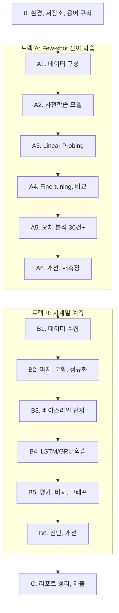

# A6-2 단계별 실습 가이드 — 전이 학습과 시계열 예측의 성능 진단

이 문서는 빈 저장소에서 시작해 제출까지 가는 순서를 안내합니다. 각 단계는 **목표 / 할 일 / 힌트 / 확인 방법**으로 구성되며, 확인 방법(체크포인트)을 통과한 뒤 다음으로 넘어갑니다. 완성 코드는 없습니다. 개념이 막히면 [LEARNING_GUIDE.md](LEARNING_GUIDE.md)의 해당 장을 먼저 읽습니다.

- 과제 원문: [../subject.md](../subject.md)
- 개념 정리: [LEARNING_GUIDE.md](LEARNING_GUIDE.md)

## 전체 흐름

두 트랙 모두 필수이며 같은 사이클(베이스라인 → 딥러닝 → 진단/오차 분석 → 개선과 정량화)을 따릅니다.



트랙 순서는 바꿔도 됩니다. 단, **트랙 B에서 베이스라인(B3)은 반드시 딥러닝 학습(B4) 전에** 구현하고 측정합니다.

## 요구사항 한눈에 보기

| 구분 | 내용 | 출처 |
| --- | --- | --- |
| 프레임워크 | Python 3.10 이상, PyTorch 또는 TensorFlow | 6장 |
| GPU | 권장, 없어도 수행 가능 | 7장 |
| 데이터 (A) | 클래스당 50장 미만, CNN 사전학습 모델(ResNet, EfficientNet 등) | 4장 1 |
| 데이터 (B) | 1개 티커, 최소 3년 일봉, Train/Validation/Test = 7/1/2 시간순 | 4장 2 |
| 순서 제약 | 베이스라인을 딥러닝 학습 전에 구현·측정 | 7장 |
| 오차 분석 | 사람이 실제 오분류 데이터를 직접 확인 (Human-in-the-loop), 최소 30건 | 2장, 7장 |
| 누수 | 미래 정보가 학습에 들어가지 않게, 4개 체크포인트 준수와 근거 기술 | 4장 4, 7장 |
| 용어 | Train / Validation / Test로 통일 (Dev, Val 혼용 금지) | 7장 |
| 제출 | GitHub 저장소 URL | 2장 |

## 0단계. 환경, 저장소 구조, 용어 규칙

**목표:** 실행 환경과 결과물 위치를 정하고, 용어 규칙을 처음부터 적용한다.

**할 일**

1. 가상환경을 만들고 PyTorch(+torchvision) 또는 TensorFlow를 설치합니다. 데이터 처리와 그래프용으로 pandas, Matplotlib, 트랙 B용으로 yfinance를 설치합니다. scikit-learn은 Scaler나 지표 계산에 편리합니다(권장).
2. 설치 목록을 `requirements.txt`로 남깁니다(권장).
3. 아래 구조를 참고해 폴더를 만듭니다. 레포지토리 구조는 자유이므로 모두 권장 예시입니다.

```text
repo/
├── track_a_transfer/     # 데이터 구성, 학습(모드: linear_probe / finetune), 평가, 오분류 추출
├── track_b_timeseries/   # 수집, 분할/전처리, 베이스라인, RNN 모델, 평가
├── data/                 # 원본 CSV, 이미지 (용량이 크면 .gitignore, README에 받는 법)
├── figures/              # 필수 시각화 4종
├── reports/
│   ├── diagnosis_report.md         # 성능 진단 리포트
│   ├── error_analysis.md           # 오차 분석표와 통계
│   ├── baseline_comparison.md      # 베이스라인 비교 리포트
│   └── data_leakage.md             # 누수 방지 근거 섹션
└── README.md             # 권장: 실행 방법과 결과물 위치 안내
```

**힌트:** 코드 변수명, 그래프 범례, 파일명에서도 `val` 대신 `validation`을 쓰면 문서와 용어가 어긋날 일이 없습니다(권장). 최소한 **리포트와 그래프 범례**에는 반드시 Validation이라고 씁니다.

**확인 방법**

- [ ] `python -c "import torch, torchvision"` (또는 `import tensorflow`)가 동작
- [ ] GPU가 있다면 인식되는지, 없다면 CPU로 진행할 계획(작은 이미지 수, 작은 모델)

## A1단계. Few-shot 이미지 데이터 구성

**목표:** 클래스당 Train 50장 미만의 데이터셋을 Train/Validation/Test로 나눈다.

**할 일**

1. 과제 추천 데이터셋(Dogs vs Cats, Food-101 일부, Oxford Flowers 102 일부, CIFAR-10 일부) 중 하나를 고르고 클래스를 정합니다.
2. 클래스별로 Train(50장 미만), Validation, Test 이미지를 무작위로 고르되 시드를 고정합니다.
3. 필요한 클래스만 별도 폴더로 복사합니다(`shutil`, `os`). 클래스별 폴더 구조로 두면 `ImageFolder` 같은 도구로 바로 읽을 수 있습니다.
4. 각 세트의 클래스별 장수를 표로 남깁니다.

**힌트**

- 오차 분석에 오분류 **30건 이상**이 필요합니다. Test가 작거나 클래스가 너무 쉬우면 30건이 안 나올 수 있습니다. 비슷한 클래스를 고르거나 클래스 수를 늘리는 등 미리 계획합니다. 어떻게 30건을 확보했는지는 리포트에 밝힙니다([LEARNING_GUIDE.md 6장](LEARNING_GUIDE.md#6-few-shot-데이터-구성과-이미지-증강)).
- 각 이미지의 파일명(또는 데이터셋 인덱스)을 보존해야 나중에 오차 분석표에 적을 수 있습니다. CIFAR-10처럼 파일명이 없으면 `cifar_test_00123`처럼 인덱스로 이름을 만듭니다.

**확인 방법**

- [ ] 모든 클래스의 Train 장수가 50 미만
- [ ] Train, Validation, Test 사이에 중복 파일이 없음 (파일명 집합의 교집합이 비어 있음)
- [ ] 각 세트에서 몇 장을 열어 보면 라벨과 내용이 맞음

## A2단계. 사전학습 모델 불러오기

**목표:** ImageNet 사전학습 CNN을 불러와 분류층을 내 클래스 수로 교체하고, 올바른 전처리를 준비한다.

**할 일**

1. ResNet 또는 EfficientNet 계열의 사전학습 가중치를 불러옵니다.
2. 마지막 분류층을 내 클래스 수에 맞는 새 층으로 바꿉니다.
3. 사전학습 가중치에 맞는 전처리(크기 조정, ImageNet 정규화)를 Validation/Test용으로 준비합니다. Train용은 여기에 증강을 더할 수 있습니다(A6).

**힌트 (PyTorch 예시)**

```python
from torchvision import models
weights = models.ResNet18_Weights.DEFAULT
model = models.resnet18(weights=weights)
preprocess = weights.transforms()   # 이 가중치에 맞는 전처리
# TODO: model.fc를 내 클래스 수에 맞게 교체
```

TensorFlow를 쓴다면 `tf.keras.applications`의 모델을 `include_top=False`로 불러와 분류 헤드를 붙이는 방식이 대응됩니다.

**확인 방법**

- [ ] 배치 하나를 넣으면 출력 shape가 `(배치, 클래스 수)`
- [ ] 학습 전 정확도가 대략 찍기 수준(1/클래스 수) 근처

## A3단계. Linear Probing 학습

**목표:** 백본을 동결하고 분류층만 학습해, 비교 기준이 되는 성능과 Loss 곡선을 얻는다.

**할 일**

1. 분류층을 제외한 모든 파라미터를 동결합니다.
2. 학습 가능한 파라미터 수를 출력해 동결이 됐는지 확인합니다.
3. 에폭마다 Train Loss와 Validation Loss(그리고 정확도)를 기록합니다.
4. Validation 기준으로 가장 좋은 에폭의 모델을 저장합니다(권장: 조기 종료).
5. Train/Validation Loss 곡선을 그려 `figures/`에 저장합니다.

**힌트**

- 동결은 `requires_grad = False`이고, 옵티마이저에는 학습할 파라미터만 넘기는 것이 깔끔합니다.
- PyTorch에서 `model.train()` 상태면 동결된 BatchNorm의 통계가 계속 바뀝니다. 백본을 평가 모드로 둘지 정하고 리포트에 적습니다([LEARNING_GUIDE.md 5장](LEARNING_GUIDE.md#5-전이-학습-linear-probing-vs-fine-tuning)).
- 모든 실험에서 같은 시드, 같은 데이터 분할을 씁니다.

**확인 방법**

- [ ] 학습 가능한 파라미터 수가 분류층 크기와 같음 (ResNet-18, 3클래스라면 1,539개)
- [ ] Loss 곡선 그래프가 저장됨, 범례가 Train / Validation
- [ ] Validation 정확도가 찍기 수준보다 확실히 높음

## A4단계. 전체 Fine-tuning과 비교

**목표:** 모든 층을 학습하는 Fine-tuning을 수행하고 Linear Probing과 성능·곡선을 비교한다.

**할 일**

1. 같은 사전학습 가중치에서 새로 시작해 모든 층의 동결을 풉니다.
2. Linear Probing보다 작은 학습률로 학습합니다(필요하면 층별로 다른 학습률).
3. A3과 똑같이 Train/Validation Loss를 기록하고 곡선을 저장합니다.
4. 두 방식의 Test 정확도(와 Loss)를 표로 비교합니다.
5. 각 곡선의 격차를 보고 High Bias / High Variance를 진단합니다.

**힌트**

- 데이터가 적으면 Fine-tuning의 Train Loss는 빨리 0에 가까워지고 Validation Loss는 올라갈 수 있습니다. 이것 자체가 High Variance 진단 근거입니다.
- 마지막 블록만 푸는 부분 Fine-tuning을 추가로 비교하면 Layer Freezing 전략을 근거 있게 정할 수 있습니다(권장).
- 하이퍼파라미터는 Validation으로 정하고, Test는 최종 비교에만 씁니다.

**확인 방법**

- [ ] 두 실험 모두 Train/Validation Loss 곡선이 있음
- [ ] 비교표에 Test 정확도와 학습 파라미터 수가 있음
- [ ] 각 실험의 진단(편향/분산)과 해결 전략을 한두 문장으로 쓸 수 있음

## A5단계. 오분류 추출과 오차 분석표

**목표:** 오분류 이미지를 직접 보고 태깅해 최소 30건의 오차 분석표와 태그 통계, 갤러리를 만든다.

**할 일**

1. Test(필요하면 리포트에 밝힌 범위)의 예측 결과에서 틀린 샘플만 골라 파일명, 실제 클래스, 예측 클래스, 신뢰도(Softmax 최댓값)를 CSV 등으로 저장합니다.
2. 이미지를 **한 장씩 직접 열어 보고** 실패 원인 태그를 붙입니다. 과제의 권장 카테고리(데이터 품질, 배경/잡음, 클래스 유사성, 라벨 오류, 모델 한계)를 기준으로 세부 태그(어두운 조명, 일부만 보임, 유사 품종 등)를 씁니다.
3. 과제 템플릿 형식(번호 / 파일명 / 실제→예측 / 신뢰도 / 실패 원인 태그)으로 표를 만듭니다.
4. 태그별 건수와 비율 표를 만듭니다.
5. 태그별로 묶은 오분류 이미지 갤러리를 그려 `figures/`에 저장합니다.

**힌트**

```python
fig, axes = plt.subplots(n_rows, n_cols, figsize=(...))
# TODO: 태그별로 행을 나누고, 각 칸 제목에 "실제→예측 (신뢰도)"
```

- 갤러리에 그릴 때는 정규화를 되돌린(또는 원본) 이미지를 써야 색이 정상으로 보입니다.
- 한 이미지에 원인이 여럿이면 주 원인 하나를 정하는 규칙을 두면 통계가 깔끔합니다(권장).
- 태그는 모델 신뢰도나 자동 규칙으로 채우지 않습니다. 과제 제약 사항입니다.

**확인 방법**

- [ ] 오차 분석표가 30행 이상
- [ ] 태그별 건수 합이 전체 오분류 건수와 맞음 (다중 태그면 그 규칙을 표기)
- [ ] 갤러리가 태그별로 그룹화되어 있음

## A6단계. 개선 적용과 재측정

**목표:** 진단과 오차 분석 결과에 근거한 개선을 적용하고 전후를 같은 기준으로 비교한다.

**할 일**

1. 가장 비율이 큰 태그나 진단 결과에 맞는 개선책을 고릅니다. 예: 어두운 조명 → 밝기 증강, High Variance → 증강·Dropout·정규화, High Bias → 동결 해제 범위 확대.
2. 증강은 Train 전처리에만 넣습니다.
3. 같은 분할, 같은 Test로 재학습·재평가하고 전후 정확도와 태그 분포를 비교합니다.

**힌트:** 결과 예시 문장처럼 "원인 비율 → 적용한 조치 → 수치 변화"를 한 줄로 요약할 수 있으면 됩니다. 개선이 없었다면 그 결과도 그대로 쓰고 이유를 분석합니다.

**확인 방법**

- [ ] 개선 전후 수치 비교가 리포트에 있음
- [ ] 개선 후에도 Loss 곡선을 다시 그려 진단이 바뀌었는지 확인

## B1단계. 시계열 데이터 수집

**목표:** 1개 티커의 최소 3년 일봉 데이터를 받아 저장한다.

**할 일**

1. `yfinance`로 티커 하나의 일봉을 받습니다. 시작일과 종료일을 명시해 3년 이상이 되게 합니다. 인터넷이 안 되면 제공 CSV를 씁니다.
2. 결측치를 확인하고 처리 방식을 기록합니다.
3. 받은 데이터를 CSV로 저장해 이후 실험은 이 파일로 진행합니다(권장: 재현성).
4. 예측 대상 컬럼(예: 종가)을 정합니다.

**힌트:** 최근 yfinance 버전은 컬럼이 티커와 함께 다중 인덱스로 나오거나 수정 주가 설정이 기본값으로 바뀌었을 수 있습니다. `data.columns`와 `data.head()`를 꼭 출력해 보고, 어떤 가격을 썼는지 리포트에 적습니다.

**확인 방법**

- [ ] 행 수가 약 750개 이상 (3년 × 연 약 252 거래일)
- [ ] 날짜 인덱스가 오름차순이고 중복이 없음
- [ ] 결측치 0개 (처리 후)

## B2단계. 피처 생성, 시간순 분할, 정규화

**목표:** 누수 방지 체크포인트 1·2·4를 지키며 데이터를 준비한다.

**할 일**

1. 지연값, 이동평균 같은 피처를 쓴다면 **분할 전에** 과거만 보는 방식으로 만듭니다(체크포인트 4).
2. 시간 순서대로 Train 70%, Validation 10%, Test 20%로 나눕니다. 섞지 않습니다(체크포인트 1).
3. Scaler를 Train 구간에만 `fit`하고, Validation/Test는 `transform`만 합니다(체크포인트 2).
4. 각 구간의 시작일·종료일·행 수를 기록합니다.

**힌트**

- 분할은 인덱스 슬라이싱으로 충분합니다. 무작위 분할 함수를 기본 설정으로 쓰면 섞일 수 있습니다.
- 이동평균 피처는 `shift(1)`로 $t-1$까지만 포함하게 하고 `center=True`를 쓰지 않습니다.
- 왜 피처는 분할 전, Scaler는 분할 후인지의 근거는 [LEARNING_GUIDE.md 13장](LEARNING_GUIDE.md#13-data-leakage-데이터-누수)에 있습니다. 이 설명을 누수 방지 근거 섹션에 자기 말로 씁니다.

**확인 방법**

- [ ] Train 마지막 날짜 < Validation 첫 날짜, Validation 마지막 날짜 < Test 첫 날짜
- [ ] 정규화 후 Train 구간 값은 정해진 범위(예: 0~1) 안, Test는 범위를 벗어날 수 있음
- [ ] Scaler의 `fit`이 코드 전체에서 Train 데이터에만 호출됨

## B3단계. 베이스라인 구현과 측정 (딥러닝 전에)

**목표:** 베이스라인을 최소 2개 구현하고 Test 구간에서 MAE, RMSE, MAPE를 측정한다.

**할 일**

1. Naive, SMA, EMA, 선형 회귀 중 2개 이상을 고릅니다. SMA는 창 5/10/20, EMA는 $\alpha$ 0.1/0.3/0.5 중에서 선택합니다(여러 값 비교 권장).
2. 각 베이스라인으로 Test 구간의 각 날짜를 원스텝 예측합니다. 예측에는 그 날짜 이전의 실제 값만 씁니다.
3. 가격 단위로 MAE, RMSE, MAPE를 계산하는 함수를 직접 만들거나 라이브러리로 계산합니다.
4. 결과를 표로 저장합니다. 이 결과는 LSTM/GRU 학습 전에 확정합니다.

**힌트**

- `rolling(n).mean()`과 `ewm(...).mean()`은 당일 값을 포함하므로 예측으로 쓰려면 한 칸 밀어야 합니다.
- 선형 회귀의 계수는 Train 구간으로만 구합니다.
- 지표 함수는 [LEARNING_GUIDE.md 12장](LEARNING_GUIDE.md#12-회귀-평가-지표)의 손 계산 예시($y = [100, 102, 101]$, $\hat{y} = [101, 100, 103]$ → MAE 1.667, RMSE 1.732, MAPE 약 1.65%)로 먼저 검증합니다.
- 베이스라인을 먼저 했다는 근거로, 베이스라인 결과 파일과 커밋을 딥러닝 코드보다 먼저 남겨 두면 좋습니다(권장).

**확인 방법**

- [ ] 지표 함수가 손 계산 예시와 같은 값을 냄
- [ ] Naive 예측 배열이 실제 값을 정확히 한 칸 민 것과 같음
- [ ] 모든 베이스라인의 예측 날짜 집합이 Test 구간과 정확히 같음

## B4단계. 윈도우 생성과 LSTM/GRU 학습

**목표:** 미래 값을 포함하지 않는 윈도우로 LSTM 또는 GRU를 학습하고 Train/Validation Loss를 기록한다.

**할 일**

1. 길이 $L$의 슬라이딩 윈도우로 (입력 $[y_{t-L}, \dots, y_{t-1}]$, 정답 $y_t$) 쌍을 만듭니다(체크포인트 3).
2. 정답 날짜가 어느 구간에 속하는지로 Train/Validation/Test 샘플을 나눕니다. 구간 경계의 입력이 직전 구간에 걸치는 것은 과거 값이므로 허용됩니다.
3. 모델: LSTM 또는 GRU 층 + 출력용 Linear 층. 손실은 MSE 등.
4. 에폭마다 Train Loss와 Validation Loss를 기록하고, Validation 기준으로 최적 모델을 저장합니다.
5. Train/Validation Loss 곡선을 `figures/`에 저장합니다.

**힌트**

```python
class RNNForecaster(nn.Module):
    def __init__(self, input_size=1, hidden_size=..., num_layers=...):
        ...  # TODO: nn.LSTM(..., batch_first=True) 또는 nn.GRU, 출력 Linear
    def forward(self, x):          # x: (batch, L, input_size)
        ...  # TODO: 마지막 시점 은닉 상태 → Linear → (batch, 1)
```

- 윈도우 생성 직후 첫 샘플을 출력해, 입력의 마지막 값과 정답이 원본에서 연속된 두 날짜인지 눈으로 확인합니다.
- 분할 단계의 shuffle은 금지입니다. Train 윈도우의 학습 순서를 섞을지는 선택하고 이유를 적습니다([LEARNING_GUIDE.md 13장](LEARNING_GUIDE.md#13-data-leakage-데이터-누수)).

**확인 방법**

- [ ] 입력 shape `(샘플 수, L, 특성 수)`, 정답 shape `(샘플 수, 1)`
- [ ] 어떤 샘플에서도 정답 날짜가 입력 날짜 범위 안에 없음
- [ ] Train/Validation Loss 곡선 저장, 범례 Train / Validation

## B5단계. Test 평가, 베이스라인 비교, 시각화

**목표:** 같은 Test 구간에서 딥러닝 모델과 베이스라인을 비교하고 개선율을 정량화한다.

**할 일**

1. 저장한 최적 모델로 Test를 예측하고 **가격 단위로 역변환**합니다.
2. MAE, RMSE, MAPE를 베이스라인과 같은 함수로 계산합니다.
3. 모델명 / MAE / RMSE / MAPE(%) 비교표를 만들고, 각 베이스라인 대비 개선율(%)을 계산합니다.
4. 예측 vs 실제 그래프(X: 시간, Y: 값, 실제 파란선 + 예측 빨간선)를 저장합니다.
5. 베이스라인 비교 막대그래프(X: 모델명, Y: MAE/RMSE)를 저장합니다.

**힌트**

- 개선율 = (베이스라인 오차 − 모델 오차) / 베이스라인 오차 × 100. 음수가 나와도 그대로 보고합니다.
- 예측선이 실제선을 하루 늦게 따라가면 모델이 Naive를 흉내 내는 것일 수 있습니다. 그래프 일부를 확대해 확인합니다.
- 비교표의 각 모델 예측 개수가 같아야 합니다.

**확인 방법**

- [ ] 모든 모델이 같은 Test 날짜에서 평가됨 (예측 개수와 시작·종료일 일치)
- [ ] 비교표와 개선율이 리포트에 있음
- [ ] 그래프 2종(예측 vs 실제, 막대그래프)이 `figures/`에 있음

## B6단계. 진단과 개선

**목표:** Loss 곡선과 비교 결과로 상태를 진단하고, 해결책을 적용하거나 리포트에 명시한다.

**할 일**

1. Train/Validation Loss의 수준과 격차로 High Bias / High Variance를 판단합니다. Train 오차가 Naive 오차보다도 크다면 High Bias 신호입니다.
2. 진단에 맞는 조치(은닉 크기·층 수·윈도우 길이 조정, Dropout, 조기 종료 등)를 적용하고 다시 비교합니다.
3. 시계열 증강(Jittering, Time-warping)은 금융 데이터 특성을 훼손할 수 있으므로 과제의 주의 사항을 확인하고, 쓰지 않는다면 그 이유를 적습니다.

**확인 방법**

- [ ] 진단 → 조치 → 결과 변화가 리포트에 있음
- [ ] 조치 선택에 Test가 아니라 Validation을 사용함

## C단계. 리포트 정리와 제출

**목표:** 과제의 결과물 6가지를 저장소에서 바로 찾을 수 있게 정리한다.

| 결과물 | 들어갈 내용 |
| --- | --- |
| 1. 소스 코드 | 트랙 A 전이 학습, 트랙 B RNN 모델과 베이스라인 |
| 2. 성능 진단 리포트 (Markdown) | 각 실험의 Loss 곡선, 편향/분산 진단, 해결 전략과 결과 |
| 3. 오차 분석표 | 30건 이상의 태깅 표, 태그별 통계, 개선 방향 |
| 4. 베이스라인 비교 리포트 | 모델별 MAE/RMSE/MAPE 표, 개선율(%) |
| 5. 시각화 4종 | Train/Validation Loss 곡선, 예측 vs 실제, 베이스라인 비교 막대그래프, 오분류 이미지 갤러리 |
| 6. 누수 방지 근거 섹션 (Markdown) | 체크포인트 4개 각각을 어떻게 지켰는지 코드 위치와 함께 |

**힌트:** 각 리포트에서 그래프를 이미지로 삽입하고, 실행 방법(어떤 스크립트를 어떤 순서로)을 README에 정리하면 검토자가 결과를 재현하기 쉽습니다(권장). 마지막으로 모든 문서에서 `Dev`, `Val` 표기를 검색해 `Validation`으로 고칩니다.

**확인 방법**

- [ ] 저장소 전체에서 `Dev`, `Val` 같은 혼용 표기가 없음
- [ ] 리포트의 숫자와 실제 실행 출력이 일치
- [ ] 원격 저장소에 모든 파일이 올라감

## 자주 겪는 문제

| 증상 | 흔한 원인 | 확인할 곳 |
| --- | --- | --- |
| 정확도가 찍기 수준에서 안 움직임 | 전처리 불일치(정규화 누락), 분류층 교체 누락, 옵티마이저에 파라미터 미전달 | A2, A3 |
| Linear Probing인데 학습 파라미터가 수백만 개 | 동결 누락 | 학습 가능한 파라미터 수 출력 |
| Fine-tuning이 Linear Probing보다 훨씬 나쁨 | 학습률이 너무 큼, 과적합 | 학습률, Loss 곡선 |
| 오분류가 30건 미만 | Test가 작거나 클래스가 쉬움 | A1의 클래스·분할 계획 |
| 갤러리 이미지 색이 이상함 | 정규화된 텐서를 그대로 그림 | 정규화 되돌리기 |
| 베이스라인 성능이 비정상적으로 좋음 | 이동평균에 당일 값 포함 (`shift` 누락) | B3 |
| LSTM Test 성능이 너무 좋음 | Scaler를 전체로 fit, 윈도우에 정답 포함 | B2, B4 체크포인트 |
| LSTM 지표가 베이스라인과 단위가 다름 | 역변환 누락 | B5 |
| 예측선이 하루 늦게 따라감 | 모델이 사실상 Naive를 학습 | B5 그래프 확대, 분석에 기술 |
| yfinance 컬럼 접근 오류 | 다중 인덱스 컬럼 | `data.columns` 출력 |

## 보너스 과제 (선택)

필수 항목을 끝낸 뒤 시도합니다. 힌트만 제공합니다.

**1. 하이퍼파라미터 탐색 전략**

- Grid Search 대신 Random Search 또는 Coarse-to-Fine을 적용합니다. 학습률처럼 자릿수가 넓은 값은 로그 스케일에서 뽑습니다.
- 평가 기준은 Validation 성능입니다. Test는 최종 1회만 봅니다.
- 각 시도의 (파라미터 값, Validation 성능)을 기록해 파라미터별 산점도를 그리면 어떤 파라미터가 영향이 큰지 드러납니다.
- 개념은 [LEARNING_GUIDE.md 15장](LEARNING_GUIDE.md#15-보너스-개념-선택-과제용)을 봅니다.

**2. Attention 메커니즘**

- LSTM/GRU의 모든 시점 출력에 점수를 매기고 Softmax 가중합으로 문맥 벡터를 만드는 Attention 층을 추가하거나, Transformer 기반 모델을 적용합니다.
- 같은 Test 구간에서 기존 모델·베이스라인과 같은 지표로 비교합니다.
- Attention 가중치를 시점별로 그려 모델이 어떤 과거 날짜를 중요하게 봤는지 해석하면 "중요 정보 선별" 효과를 보여 줄 수 있습니다.

## 최종 자가 점검표

| subject.md 요구사항 | 어디서 확인하는지 |
| --- | --- |
| 클래스당 50장 미만 환경에서 CNN 사전학습 모델로 전이 학습 | A1 장수 표, A2 코드 |
| Linear Probing vs Fine-tuning 성능 비교 | A4 비교표 |
| 오분류 이미지 추출, 직접 확인 후 태깅 | A5 CSV와 오차 분석표 |
| 오차 분석표 최소 30건 + 태그 통계 | `reports/` 오차 분석 문서 |
| yfinance 등 주가/경제 데이터를 LSTM/GRU로 예측 | B1, B4 코드 |
| 1개 티커, 최소 3년 일봉 | B1 체크포인트 |
| Train/Validation/Test = 7/1/2 시간순 분할 | B2 구간 날짜 기록 |
| 정규화는 Train 통계로만 fit | B2 코드, 누수 방지 섹션 |
| 베이스라인 최소 2개 구현 | B3 코드 |
| 베이스라인을 딥러닝 학습 전에 구현·측정 | B3 결과 파일, 커밋 순서 |
| 모든 모델을 동일 Test 구간에서 평가 | B5 체크포인트 |
| MAE, RMSE, MAPE 비교 + 개선율(%) | 베이스라인 비교 리포트 |
| 각 실험의 Train/Validation Loss 곡선 | `figures/`, 진단 리포트 |
| High Bias / High Variance 진단과 해결 전략 명시 | 성능 진단 리포트 |
| 누수 방지 체크포인트 4개 준수와 근거 기술 | 누수 방지 근거 섹션 |
| 시계열 증강 금지/주의 범주 확인 | B6, 리포트 |
| 시각화 4종 (Loss 곡선, 예측 vs 실제, 비교 막대, 오분류 갤러리) | `figures/` |
| 사람이 직접 오분류 데이터를 확인 (Human-in-the-loop) | 오차 분석표의 태그와 갤러리 |
| 용어 Train/Validation/Test 통일 | C단계 검색 |
| PyTorch 또는 TensorFlow, Python 3.10 이상 | 환경 기록, `requirements.txt` |
| GitHub 저장소 URL 제출 | 원격 저장소 확인 |
